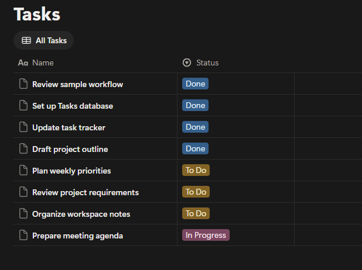
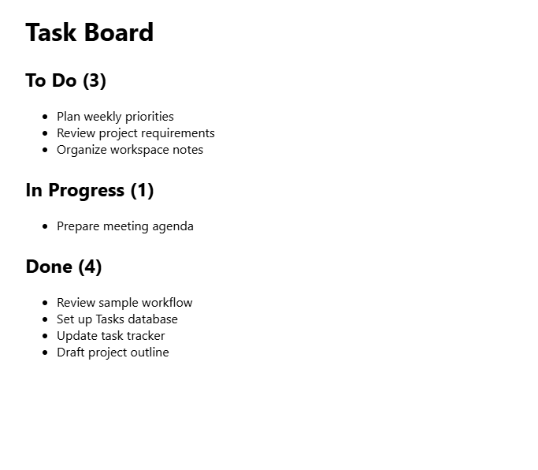
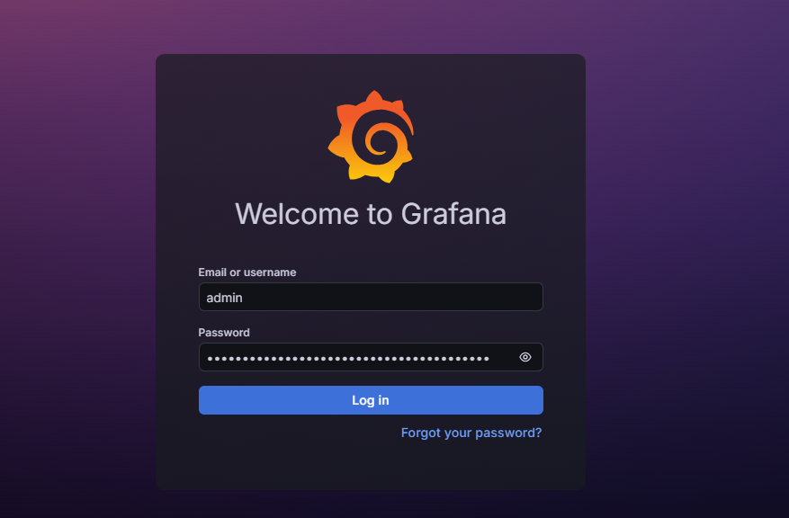
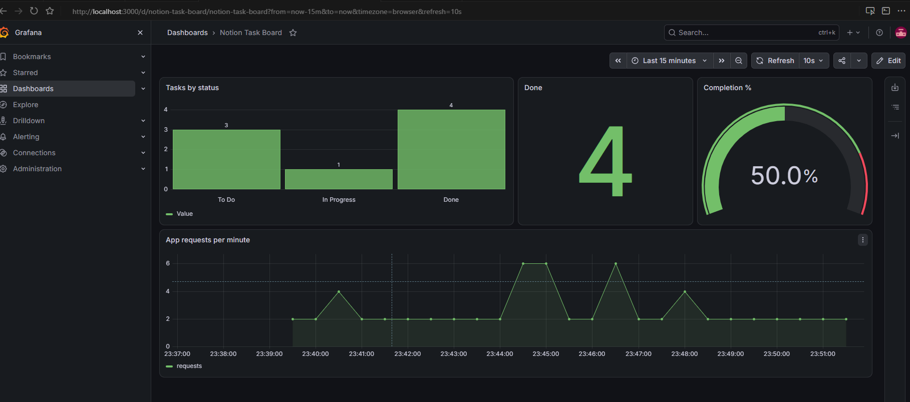

# Notion Task Board on Kubernetes

A 3-hour hands-on workshop project. Participants build a small Flask app that reads tasks from a Notion database, deploy it to a local Kubernetes cluster, collect its metrics with Prometheus, and chart them live in Grafana.

**Stacks:** CNCF (Kubernetes, Helm, Prometheus) · Grafana · Notion · Devin Desktop · GitHub Copilot CLI

**The demo moment:** move a task to **Done** in Notion, and within about 30 seconds the Grafana dashboard updates (for example, Done 2 → 3 and completion 25% → 37.5%).

Every step below was tested end to end on an Apple Silicon Mac.

---

## Architecture

```
Notion (Tasks database)
        │  Notion API, polled every 30 s
        ▼
┌──────────────────────── kind cluster (Kubernetes) ────────────────────────┐
│                                                                           │
│  task-board Pod (Flask :8000) ──/metrics──▶ Prometheus ──PromQL──▶ Grafana │
│        ▲                         scraped every 30 s     refreshed every 10 s│
│  Service task-board :80 → 8000                                            │
└───────────────────────────────────────────────────────────────────────────┘
        ▲
   kubectl port-forward 8080:80  (your browser)
```

| Component | Stack | Role |
| --- | --- | --- |
| Tasks database | Notion | Source of truth for tasks |
| Task Board app | Python Flask (generated with Devin Desktop) | Shows tasks, exposes `/metrics` |
| kind cluster | Kubernetes + Helm | Runs the app and the monitoring stack |
| Prometheus | kube-prometheus-stack | Scrapes and stores task counts |
| Dashboard | Grafana | Visualizes the counts |
| Terminal assistant | GitHub Copilot CLI | Runs and debugs cluster commands |

## Concepts for beginners

### Kubernetes
Software that runs your apps on a group of computers and keeps them running. You tell it what you want (“run one copy of my app”), and it makes that happen and fixes things if they break.

*Use case:* a website that must stay up 24/7. If a server crashes at 3 a.m., Kubernetes restarts the app somewhere else without anyone waking up.

### kind cluster
“Kubernetes in Docker.” kind is a **tool that creates a cluster**, not a special type of cluster. The cluster it makes is normal Kubernetes; kind just runs each “machine” as a Docker container instead of a real server. A *cluster* is the set of machines Kubernetes manages; here, that’s one container (`workshop-control-plane`). The same YAML works on kind as on a cloud cluster.

*Use case:* learning and testing Kubernetes for free, offline, without renting cloud servers.

**kind isn’t required.** It’s one of several ways to run Kubernetes on a laptop:

| Tool | What it is |
| --- | --- |
| **kind** | Kubernetes nodes as Docker containers. Fast, light, easy to delete. Used in this workshop |
| **minikube** | The classic local option; runs a VM or a container |
| **k3d / k3s** | Lightweight Kubernetes, popular on small servers and Raspberry Pi |
| **Docker Desktop’s Kubernetes** | Turned on with one checkbox in Docker Desktop settings |
| **MicroK8s** | Canonical’s local Kubernetes, common on Ubuntu |

We use kind because it behaves the same on macOS, Windows and Linux and starts in about a minute.

### Do you need Docker Desktop?
kind needs a container runtime (Docker or Podman). Containers are a Linux feature, so:

- **Linux:** no Docker Desktop needed. Plain **Docker Engine** is enough, and it’s the lightest setup.
- **macOS:** containers run inside a hidden Linux VM. Docker Desktop provides it; free alternatives include OrbStack, Colima, Rancher Desktop and Podman Desktop.
- **Windows:** Docker Desktop runs the Linux part through **WSL2**. Alternatively, install Docker Engine inside a WSL2 Ubuntu and run everything there.

Only the install step differs; every workshop command after that is the same.

### Pod
The smallest thing Kubernetes runs: a wrapper around your app’s container (usually just one). Pods are disposable; if one dies, Kubernetes makes a new one.

*Comparison:* if Kubernetes is a restaurant manager, a Pod is one cook. Cooks can be replaced; the kitchen keeps working.
*In this project:* the `task-board` Pod is the Flask app running.

### Prometheus
Collects numbers from your apps on a schedule and remembers them over time. Every 30 seconds it visits each app’s `/metrics` page and records what it sees.

*Comparison:* a nurse checking a patient’s pulse every few minutes and keeping the chart.
*Use case:* tracking CPU, memory, errors, sales per minute, or here, how many tasks are Done.

### Grafana
A dashboard tool. It stores no data itself; it asks Prometheus (or other sources) for numbers and draws charts, gauges and counters.

*Comparison:* if Prometheus is the patient’s chart, Grafana is the heart-rate monitor screen everyone can glance at.

**All together:** Kubernetes (in a kind cluster) **runs** the app in a Pod → Prometheus **measures** it → Grafana **shows** it.

### Image vs container
An **image** is the recipe: your code plus everything it needs, frozen. A **container** is a running instance of that image. Here, `task-board:v1` is the image, and the container inside the `task-board` Pod is that image running. One image can start many containers.

A container’s own files are temporary: its writable layer disappears when the container is deleted. That’s why the app stores nothing itself (Notion is the source of truth), and why Prometheus’ history in kind is lost when you delete the cluster.

*Learn more:* [Docker Basics: Part 1](https://mitul-shahriyar.hashnode.dev/docker-basics-part-1) (images and containers) and [Docker Basics: Part 2](https://mitul-shahriyar.hashnode.dev/docker-basics-part-2) (storage layers and volumes).

### Reading the Dockerfile

```dockerfile
FROM python:3.12-slim                               # start from an image with Python
WORKDIR /app                                        # work inside /app
COPY requirements.txt .                             # 1. copy only the dependency list
RUN pip install --no-cache-dir -r requirements.txt  # 2. install dependencies
COPY app.py .                                       # 3. then copy the code
EXPOSE 8000                                         # document the port the app uses
CMD ["python", "app.py"]                            # what runs when the container starts
```

- **Why this order?** Each line creates a cached **layer**. Docker reuses cached layers until something changes. Because dependencies are installed *before* the code is copied, editing `app.py` only rebuilds step 3: seconds instead of reinstalling every package.
- **Why only `app.py`?** Copying specific files (not `COPY . .`) keeps `.env` and your Notion token out of the image.
- **CMD** is the default command; it can be overridden when a container starts.

*Learn more:* [Docker Basics: Part 1](https://mitul-shahriyar.hashnode.dev/docker-basics-part-1) builds a Dockerfile for a Flask app, covers layer caching, and explains CMD vs ENTRYPOINT.

### Docker vs containerd: why `kind load` is needed
You build the image with **Docker** on your laptop, but the kind node runs **containerd**, the container runtime Kubernetes uses (Kubernetes stopped using Docker directly in v1.24). They keep separate image stores, so an image in `docker images` is invisible to the cluster.

- `kind load docker-image task-board:v1 --name workshop` copies the image from Docker into the node’s containerd.
- `docker exec workshop-control-plane crictl images` checks it from the node’s side. `crictl` is the CLI for any Kubernetes container runtime.
- `imagePullPolicy: IfNotPresent` tells Kubernetes to use that local copy instead of downloading from the internet.

Skip `kind load` and the Pod fails with `ErrImagePull`.

*Learn more:* [Kubernetes 101: Part 1](https://mitul-shahriyar.hashnode.dev/kubernetes-101-part-1) explains Docker vs containerd, the CRI, the dockershim removal, and `crictl`.

### Service types: why we need port-forward

| Type | Reachable from | Typical use |
| --- | --- | --- |
| **ClusterIP** (default) | Only inside the cluster | Apps talking to each other; **ours** |
| **NodePort** | A port (30000–32767) on every node | Quick testing on bare clusters |
| **LoadBalancer** | A public IP from the cloud provider | Real traffic on EKS, GKE, AKS |

Our `task-board` Service is ClusterIP, so your browser can’t reach it directly. `kubectl port-forward svc/task-board 8080:80` opens a temporary tunnel from your laptop into the cluster. The same applies to Prometheus (9090) and Grafana (3000).

*Learn more:* [Kubernetes 101: Part 2](https://mitul-shahriyar.hashnode.dev/kubernetes-101-part-2) covers ClusterIP, NodePort and LoadBalancer Services, plus Deployments and ReplicaSets.

### Where Kubernetes gets its memory and CPU
Kubernetes doesn’t create memory or disk space; it shares out what its machines already have.

- **On your laptop (kind):** the machines are Docker containers, so Kubernetes can only use what Docker Desktop gives it. That’s why Docker’s memory is set to at least 6 GB: that’s the whole budget. If it runs out, new Pods wait in `Pending`.
- **In the cloud:** the machines are rented virtual servers (AWS EC2, Google Compute Engine, Azure VMs). Managed services (EKS, GKE, AKS) run the control plane for you. If a server dies, Kubernetes moves its Pods to the others. An autoscaler can rent more servers when needed (this costs money), and storage requests become cloud disks such as AWS EBS.

The same YAML works in both places.

### Resource requests and limits
You can tell Kubernetes how much of a machine one container should get:

```yaml
resources:
  requests: { memory: "128Mi", cpu: "100m" }   # guaranteed minimum
  limits:   { memory: "256Mi", cpu: "500m" }   # the most it may use
```

**Units:** `Mi` = mebibytes (≈ megabytes), so `128Mi` ≈ 128 MB of RAM. `m` = millicores, thousandths of a CPU core: `1000m` is one core, `100m` is 10% of a core, `500m` is half a core.

- **requests:** reserved for the app. The scheduler only places the Pod on a machine with that much free; otherwise it waits in `Pending`.
- **limits:** the ceiling. Over the CPU limit, the app is slowed down (throttled) but keeps running. Over the memory limit, it is killed (`OOMKilled`) and restarted.

*Comparison:* booking a hotel room. The request is the room you’re guaranteed; the limit is the most space the hotel lets you take.

**Why it matters:** without these, one buggy app can eat all the memory and starve everything else, on a laptop even Prometheus and Grafana. The workshop manifests leave them out to stay simple; adding them is a good stretch goal.

Under the hood, Kubernetes enforces these with the same Linux feature Docker uses (cgroups), explained in [Docker Basics: Part 2](https://mitul-shahriyar.hashnode.dev/docker-basics-part-2).

## Repository layout

```
.
├── app.py                    # Flask app: tasks page + Prometheus metrics
├── requirements.txt
├── Dockerfile
├── .env.example              # copy to .env and fill in (never commit .env)
├── .gitignore
├── .dockerignore
├── k8s/
│   ├── deployment.yaml       # image task-board:v1, reads notion-secret
│   ├── service.yaml          # label app: task-board, port named http (80 → 8000)
│   └── servicemonitor.yaml   # tells Prometheus to scrape /metrics every 30 s
├── grafana/
│   └── panels.md             # the four dashboard panels and their settings
└── docs/
    ├── devin-prompt.md       # the prompt that generates app + manifests
    ├── copilot-prompts.md    # Copilot CLI prompts tested in the build
    └── build-report.md       # what worked and what didn't in the test build
```

`app.py`, `Dockerfile` and the manifests here are reference versions. In the workshop, participants generate their own with Devin Desktop using `docs/devin-prompt.md`; these files are the fallback if anyone falls behind.

---

## Prerequisites

All platforms need: Docker (or Docker Engine on Linux), kind, kubectl, Helm, Node.js (for Copilot CLI), Python 3.10+, Devin Desktop, a Notion account, and about 8 GB RAM.

### macOS (tested)

```bash
brew install --cask docker-desktop
brew install kind kubectl helm node
npm install -g @github/copilot
```

- Open Docker Desktop once, then set **Settings → Resources → Memory** to at least 6 GB.
- Install **Devin Desktop** from Devin’s website and sign in.
- Python 3.10+ (Homebrew or Conda both work).

### Linux (Ubuntu/Debian)

- Install **Docker Engine** (no Docker Desktop needed) by following Docker’s official install guide for your distribution, then add yourself to the `docker` group so `docker` runs without `sudo`:

```bash
sudo usermod -aG docker $USER   # then log out and back in
```

- Install kind, kubectl and Helm from their official install pages (each offers a Linux binary or package).
- Install Node.js 22+ and Python 3.10+, then `npm install -g @github/copilot`.

### Windows

- Install **Docker Desktop** with the **WSL2** backend (Docker Desktop prompts you to enable WSL2 if needed).
- Easiest path: run the workshop inside a **WSL2 Ubuntu** terminal and follow the Linux steps there for kind, kubectl, Helm, Node and Python.
- Alternatively, install the tools natively with `winget` (for example `winget install Kubernetes.kind Kubernetes.kubectl Helm.Helm OpenJS.NodeJS`); the `export`, `set -a; source .env` and `base64 -d` commands below then need PowerShell equivalents, so WSL2 is recommended.

Only macOS was tested in the build; Linux and Windows steps follow the same flow.

Verify everything:

```bash
docker version && kind version && kubectl version --client && helm version && node -v && python3 --version && copilot --version
```

If `brew install node` fails with `unknown install step: remove`, run `brew update` first, then `brew reinstall node`.

---

## Stage 1 — Notion

1. Create a **full-page database** called `Tasks` (not an inline database inside another page).
2. Properties: `Name` (Title) and `Status` (Select) with options `To Do`, `In Progress`, `Done`. Keep the spelling: the Grafana queries match it exactly.
3. Add 6–8 sample tasks across the three statuses.



4. Open [notion.so/my-integrations](https://www.notion.so/my-integrations) → **Create a new connection** → **API token** (not OAuth). Name it `task-board`, then copy the token from the **Configuration** tab. It starts with `ntn_` (older tokens start with `secret_`). You must be a workspace owner.
5. On the database, open **•••** → **Connections** → add `task-board`.
6. Copy the database ID: **Share → Copy link**; the ID is the 32 characters before `?v=`.

Can’t find the ID? Ask the API which databases the connection can see:

```bash
export NOTION_TOKEN=ntn_your_token_here
curl -s https://api.notion.com/v1/search \
  -H "Authorization: Bearer $NOTION_TOKEN" \
  -H "Notion-Version: 2022-06-28" \
  -H "Content-Type: application/json" \
  -d '{"filter":{"property":"object","value":"database"}}' \
  | python3 -c "import sys,json; [print(r['id'], '-', (r['title'][0]['plain_text'] if r['title'] else '')) for r in json.load(sys.stdin)['results']]"
```

7. Create `.env` from the example, **with no quotes or spaces**:

```bash
cp .env.example .env
# then edit .env
```

## Stage 2 — Copilot CLI

```bash
copilot
```

Sign in with GitHub, then try: *“Check that docker, kind, kubectl and helm are installed and tell me what’s missing.”* More tested prompts are in `docs/copilot-prompts.md`.

Run long-running commands (`port-forward`, `python3 app.py`) in their own Terminal tab, not through Copilot.

## Stage 3 — The app (Devin Desktop)

Generate the app with the prompt in `docs/devin-prompt.md`, or use the files in this repo. Then run it locally:

```bash
python3 -m venv .venv
source .venv/bin/activate
pip install -r requirements.txt
set -a; source .env; set +a
python3 app.py
```

- `http://localhost:8000` shows tasks grouped by status.
- `http://localhost:8000/metrics` shows `notion_tasks{status="..."}` and `app_requests_total`.

**Stop it with Ctrl+C before Stage 4**, or it keeps holding port 8000.

## Stage 4 — Kubernetes

```bash
kind create cluster --name workshop
kubectl get nodes

docker build -t task-board:v1 .
kind load docker-image task-board:v1 --name workshop
docker exec workshop-control-plane crictl images | grep task-board

kubectl create secret generic notion-secret --from-env-file=.env
kubectl describe secret notion-secret   # sizes only: ~32 bytes ID, ~50 bytes token

kubectl apply -f k8s/deployment.yaml -f k8s/service.yaml
kubectl get pods -w                     # wait for 1/1 Running, then Ctrl+C
```

In a **new Terminal tab** (leave it open):

```bash
kubectl port-forward svc/task-board 8080:80
```

Open `http://localhost:8080`. The Service listens on **80**, so `8000:8000` fails.



You can see that we have 8 tasks in the database.


## Stage 5 — Prometheus

```bash
helm repo add prometheus-community https://prometheus-community.github.io/helm-charts
helm repo update
helm install monitoring prometheus-community/kube-prometheus-stack \
  -n monitoring --create-namespace --wait

kubectl apply -f k8s/servicemonitor.yaml
```

Three rules decide whether Prometheus finds the app:

1. The ServiceMonitor’s label `release: monitoring` must match the Helm release name.
2. `selector.matchLabels` matches the **Service’s** labels, not the Pod’s.
3. `endpoints.port` must be a **named** Service port (`http`).

Check it in a new tab:

```bash
kubectl -n monitoring port-forward svc/monitoring-kube-prometheus-prometheus 9090:9090
```

At `http://localhost:9090` → **Status → Targets**, `serviceMonitor/default/task-board/0` should be **UP**. The query `notion_tasks` returns one row per status.

## Stage 6 — Grafana

```bash
# admin password (never paste it into docs or slides)
kubectl -n monitoring get secret monitoring-grafana -o jsonpath="{.data.admin-password}" | base64 -d; echo

# new tab, leave open
kubectl -n monitoring port-forward svc/monitoring-grafana 3000:80
```

Log in at `http://localhost:3000` as `admin`, create a dashboard (**Auto grid → Panel**), and add the four panels in `grafana/panels.md`. Use **Code** mode for queries. Set the time range to **Last 15 minutes** and auto-refresh to **10s**.

**Test:** move a task to Done in Notion and watch the dashboard update.




The dashboard clearly shows that 4 tasks are Done out of 8 tasks. Thus 50% of the tasks are Done.

You can modify the task status in Notion and watch the dashboard update.

---

## Exercises (after the build)

### 1. Self-healing
```bash
kubectl delete pod -l app=task-board
kubectl get pods -w
```
The Deployment notices it has zero Pods instead of one and starts a new one within seconds. Restart your port-forward afterwards.

### 2. Scaling
```bash
kubectl scale deployment task-board --replicas=3
kubectl get pods -o wide
```
Three Pods now run behind the same Service. Watch the **App requests per minute** panel split across them.

Each Pod reports its own `notion_tasks`, so `sum by (status) (notion_tasks)` now **triples** the counts. Use `max by (status) (notion_tasks)` while scaled, then scale back:

```bash
kubectl scale deployment task-board --replicas=1
```

### 3. Rolling update and rollback
Change something visible in `app.py` (for example the `<h1>` title), then:

```bash
docker build -t task-board:v2 .
kind load docker-image task-board:v2 --name workshop
kubectl set image deployment/task-board task-board=task-board:v2
kubectl rollout status deployment/task-board
kubectl rollout history deployment/task-board
```

Kubernetes starts the new Pod before removing the old one, so the app never goes down. Refresh the page to see the change, then go back:

```bash
kubectl rollout undo deployment/task-board
```

*Learn more:* [Kubernetes 101: Part 2](https://mitul-shahriyar.hashnode.dev/kubernetes-101-part-2) covers scaling, rolling updates, rollbacks and update strategies.

### 4. Resource limits
Add the `resources` block from **Resource requests and limits** to `k8s/deployment.yaml` and apply it. Then set the memory limit very low (for example `"20Mi"`) and watch the Pod get `OOMKilled`. Set it back afterwards.

*Learn more:* [Docker Basics: Part 2](https://mitul-shahriyar.hashnode.dev/docker-basics-part-2) shows the same CPU and memory limits and OOM kills with plain Docker.

## Troubleshooting

| Symptom | Cause | Fix |
| --- | --- | --- |
| `python3 -m myenv1 .venv` fails | The module must be `venv` | `python3 -m venv .venv` |
| `Address already in use` on 8000 | An old `python3 app.py` is running | `lsof -nP -iTCP:8000 -sTCP:LISTEN`, then `kill <PID>` |
| Notion `401 Unauthorized` | Token mistyped or wrong prefix | Recopy it; it starts with `ntn_` |
| Notion `404 object_not_found` | Database not shared with the connection | Database **•••** → Connections → add `task-board` |
| Notion `400 ... is a page, not a database` | Page ID used instead of database ID | Use the full-page database link, or the search command above |
| `.env` changes ignored | Old values still loaded | Locally: reload `.env` and restart. In the cluster: recreate `notion-secret`, then `kubectl rollout restart deployment/task-board` |
| Pod `ErrImagePull` | Image not in kind, or wrong pull policy | `kind load docker-image task-board:v1 --name workshop`; `imagePullPolicy: IfNotPresent` |
| Pod `CrashLoopBackOff` | Missing secret or wrong env var names | `kubectl logs` the pod; recreate `notion-secret` |
| `does not have a service port 8000` | The Service listens on 80 | `kubectl port-forward svc/task-board 8080:80` |
| `curl localhost:8000` returns 200 but the cluster isn’t involved | The local app is answering | Use 8080 for the cluster; stop the local app |
| `localhost:8080` can’t be reached | Port-forward stopped | Run it in its own tab and keep it open |
| `notion_tasks` missing in Prometheus | ServiceMonitor doesn’t match the Service | Service label `app: task-board`, port name `http`; ServiceMonitor label `release: monitoring` |
| Grafana `bad_data: invalid` | `{ }` used instead of `( )`, or pasted in Builder | Switch to Code mode, paste the exact query |
| Panel “No data” but metric exists | Panel settings | Test in **Explore**, then add to dashboard from there |
| Bar chart shows thin stripes | Range query | Query options: Type **Instant**, Format **Table**; X axis `status` |

**Warnings you can ignore:** Flask’s development-server warning (fine for a workshop; use gunicorn in production), urllib3 `NotOpenSSLWarning` (macOS LibreSSL), and Flask’s python-dotenv suggestion.

## Stopping and resuming

```bash
# stop: Ctrl+C in every port-forward tab, then
docker stop workshop-control-plane

# resume
open -a Docker
docker start workshop-control-plane
kubectl get pods -A   # wait for Running, then restart port-forwards

# remove everything
kind delete cluster --name workshop
```

## Further reading

New to containers? Read the Docker posts first, then the Kubernetes ones.

### Docker
- [Docker Basics: Part 1](https://mitul-shahriyar.hashnode.dev/docker-basics-part-1): containers vs VMs, core CLI commands, port (`-p`) and volume (`-v`) mapping, and a **Dockerfile for a Flask app**, the same pattern as this project’s `Dockerfile`. Also covers CMD vs ENTRYPOINT and Docker Compose.
- [Docker Basics: Part 2](https://mitul-shahriyar.hashnode.dev/docker-basics-part-2): how isolation works (namespaces and cgroups), **CPU and memory limits and OOM kills**, which is the same idea as Kubernetes requests and limits; storage, networking and image registries.
### Kubernetes
- [Kubernetes 101: Part 1](https://mitul-shahriyar.hashnode.dev/kubernetes-101-part-1): nodes, clusters, the control plane (API server, etcd, scheduler, controllers, kubelet), **Docker vs containerd and why Kubernetes dropped dockershim**, Pods, and first `kubectl` commands. Also covers `crictl`, the tool used in Stage 4 to check the image is on the node.
- [Kubernetes 101: Part 2](https://mitul-shahriyar.hashnode.dev/kubernetes-101-part-2): ReplicaSets and **Deployments**, rolling updates and rollbacks, scaling, and **Services** (ClusterIP, NodePort, LoadBalancer). This is the background for `deployment.yaml` and `service.yaml`.
The Kubernetes 101 posts use minikube instead of kind. The concepts and `kubectl` commands are identical; only cluster creation and image loading differ (`minikube start`, `minikube image load`).

### Official docs
- [Kubernetes documentation](https://kubernetes.io/docs/home/)
- [kind quick start](https://kind.sigs.k8s.io/docs/user/quick-start/)
- [Prometheus documentation](https://prometheus.io/docs/introduction/overview/)
- [Grafana documentation](https://grafana.com/docs/grafana/latest/)

## Security

- Never commit `.env`; it’s in `.gitignore` and `.dockerignore`.
- The Dockerfile copies only `requirements.txt` and `app.py`, so the token never enters the image.
- Check secrets with `kubectl describe secret` (sizes only), never by printing values.
- Don’t put the Notion token or Grafana password in slides or docs.
